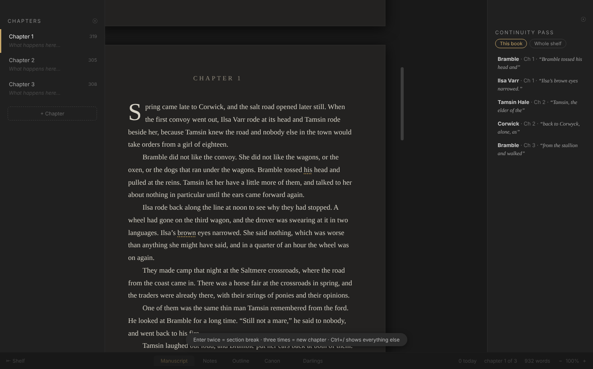
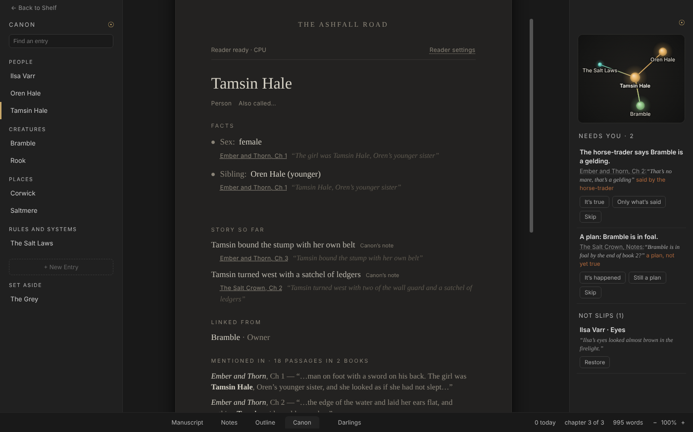
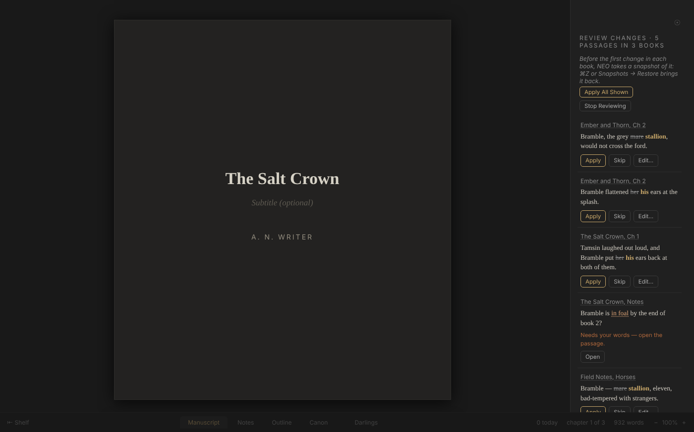
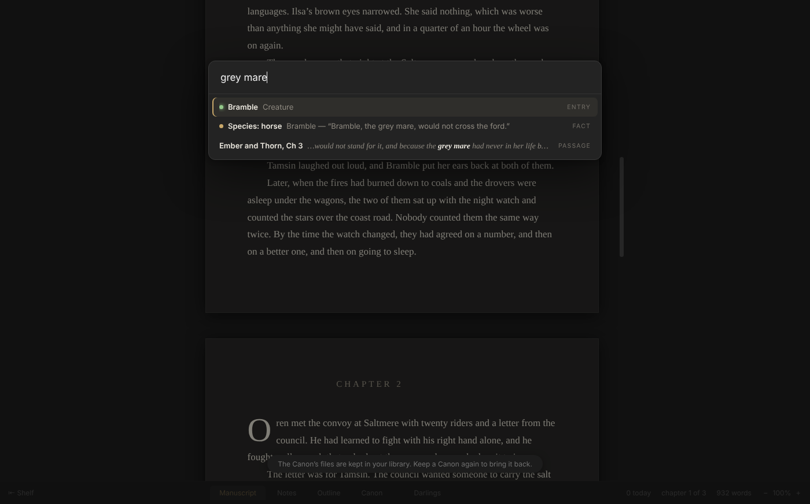
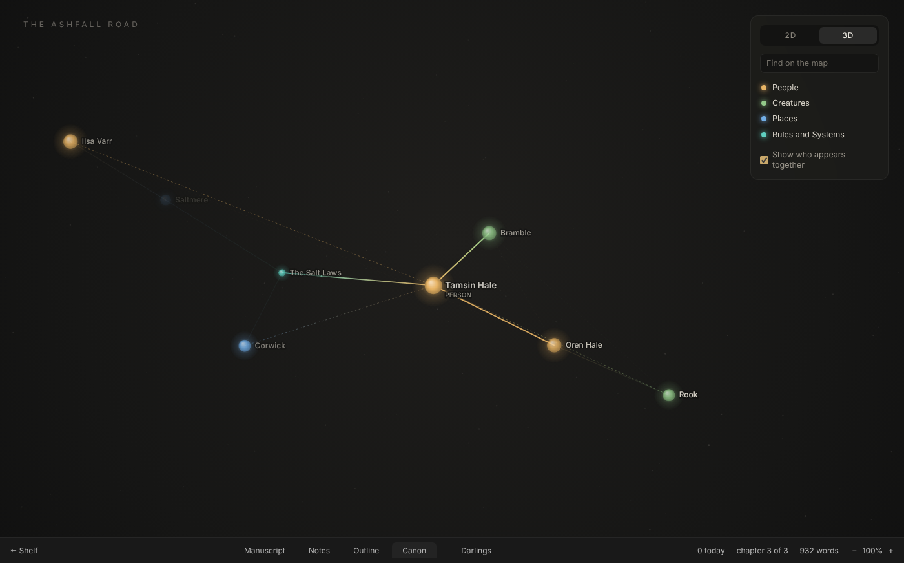
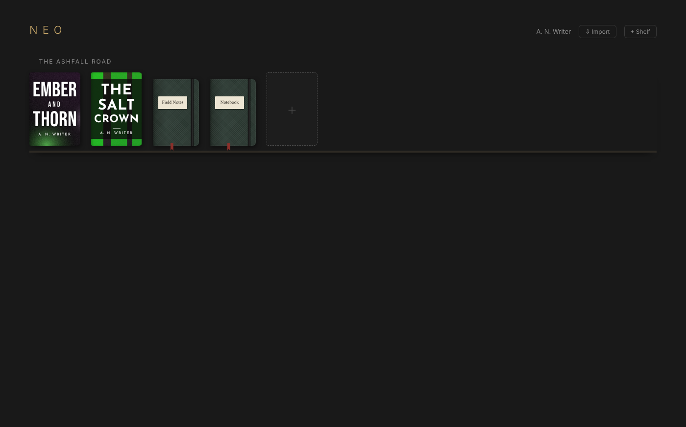

# NEO Canon

**A word processor for books that remembers your world, so you don't have to.**

<!-- DEMO VIDEO -->

## Why

Have you ever forgotten where a character was from? The dialect a town speaks? The colour of the shoes a side character wore two chapters ago?

You are in good company. George R.R. Martin famously flipped the sex of a horse between books, and a fan-historian had to set him straight. Tolkien kept notes on everything; J.K. Rowling kept fact sheets. Every long story needs a ledger of what is true in its world, and keeping one by hand is a second job on top of writing.

NEO Canon keeps the fact sheet for you, fluidly, as you write. It never interrupts a sentence. When you pause, it checks what you wrote against what you have already established, and if something slips, it shows you the line it contradicts, quoted from your own pages, with the fix one click away.



## Built on NEO

NEO Canon is built on [NEO](https://github.com/hughhowey/neo) by Hugh Howey, a distraction-free word processor for authors. Everything NEO does is still here, and a library written in one opens in the other: NEO Canon keeps the same `NEO Library` folder, and keeps its own Canon in separate `canon-*` folders that NEO ignores.

## What Canon does

- **A Canon for each shelf.** A shelf is a world: a series, a universe, one big story. Its Canon is the people, places, creatures and rules of that world.
- **Entries are plain Markdown files.** Each one lists its facts, and every fact cites the passage it came from. Open them in any editor.
- **Read the Shelf.** A local reader reads your books and proposes entries and facts. One-button download, then it works offline. Nothing leaves your computer.
- **Continuity Pass.** Run it over a book or the whole shelf. Quiet checks also run when you pause, never mid-sentence.
- **Slip popover with the exact fix.** A faint dotted mark on the word, and a card that says what is established and where. Apply the fix, change the fact, or mark it *Not a slip*.
- **Change a fact across the series.** "Bramble is now male" gives you a review list of every line affected, with a snapshot taken first, so it is one undo away.
- **Notebooks.** Free pages that live beside the Canon on the shelf.
- **Needs You.** Where the reader was unsure, it asks you instead of guessing.
- **`[[links]]` and backlinks.** Link entries to each other; every entry shows where it is mentioned.
- **In this chapter.** The entries and facts in play where your caret is.
- **⌘K Go to Anything.** Chapters, entries, facts, notebooks and commands from one box.
- **World Map, 2D and 3D.** Your world as a map of who and what connects.











### Principles

- **You are the writer.** Canon never generates prose and never suggests plot. It reads and remembers.
- **Accuracy over speed.** Every fact quotes its source. A fact that is not verified against your text never raises a slip.
- **Offline first.** The reader runs on your machine. Nothing is sent anywhere.
- **Plain files.** Canon is Markdown and JSON in your library folder.

## Download

Get the latest installer from the **[Releases page](../../releases)**:

- **macOS** — download the `.dmg` for older Intel machines or the arm64 file for Mac silicon. Open it and drag NEO Canon to Applications.
- **Windows** — get `NEO-Canon-Setup` (the installer, which keeps itself up to date) and run it, or the `portable` `.exe`, which runs without installing.

  Your library lives in `Documents\NEO Library`. If OneDrive backs up your Documents folder, that puts your books in OneDrive too; File → Library Folder… moves the library anywhere you like. If Windows Security's *Controlled folder access* is on, Windows won't let NEO Canon save in Documents: it says so when it starts, and you can allow it there or pick another folder.
- **Linux** — download the `.AppImage`, make it executable, and run it:

  ```
  chmod +x NEO-Canon-*.AppImage
  ./NEO-Canon-*.AppImage
  ```

  If it complains about a sandbox (common on Ubuntu 24.04 and newer), run it as `./NEO-Canon-*.AppImage --no-sandbox`. Your library lives in `~/Documents/NEO Library`; File → Library Folder… moves it anywhere you like.

## Everything NEO does

**The bookshelf** 

Your library looks like a bookshelf, not a file list. Labeled shelves you organize however you like — by series, by status, by pen name. Progress bars on the covers show how far you are from your word goals. You can drag-and-drop books anywhere. You can also drag shelves around and put cover art on your titles.

**Just a blank page** 

There's a white page by default or a dark mode (which I now prefer!). Controls fade until you mouse over them. Chapters number and renumber themselves automatically. Drop caps mark chapter openings, because I'm a sucker for drop-caps. Em dashes, true ellipses, and curly quotes sort themselves out as you type. Spellcheck exists only when you invoke it — no more red squiggles mid-sentence triggering your imposter syndrome.

**Enter, Enter, Enter** 

One Enter: new paragraph. Two: a `***` section break. Three: a new chapter. The goal is to KEEP WRITING.

Right-click the first chapter's heading to make it a prologue, or the last one's to make it an epilogue: they step out of the numbering, and everything renumbers.

**Darlings** 

The writing advice is "kill your darlings" — but I say: *keep the bodies*. Drag any beautiful-but-in-the-way passage onto the Darlings tab. It leaves your manuscript but isn't lost. Darlings restore to the exact spot it came from. More like zombies than darlings.

**Placeholders** 

Mid-flow and need a name, a fact, a date? ⌘⇧X drops a mark and a sticky note. The left panel shows a red dot on every chapter that you need to get back to. The right panel will list all these to-do items.

**Outlining with index cards** 

The Outline tab lays your book out as index cards, set like a page: they read left to right, line after line, so forty short chapters or a story of thirty scenes both fill the window. Each chapter starts at its big numeral, with its sections following on the same mat. Click a card and write a few lines on it. A section's note shows up in the manuscript as a gray ghost paragraph, and once you start writing, it rides one line below your words until you dismiss it. Drag a card to move it and the writing moves with it (⌘Z puts it back). Pantsers get cards too: every chapter and every *** section is already a card, showing its first line until you give it a note. Ideas without a home wait on loose cards in the right-hand panel. ⌘− shrinks the cards until a whole novel fits on one screen, and the old list is one click away. Pantsers can ignore all of it or learn to draw a freakin' map for the first time. Try it. You might like it!

**Cover Art** 

Every book gets a cover! New books are dressed in a seeded abstract (six art styles, six type templates, typefaces bundled with NEO) so no two stories on the shelf look alike. Once a story passes 1,000 words, NEO can read it and paint an abstract cover from the text. This is a bit more work but totally worth it. Get an OpenAI API key from their website and paste it into **File → Cover Art…**. The art is generated in the background for about a penny a picture. (These are not meant for publication, just writing inspiration!) The API key is stored encrypted in NEO's own settings, never in your library folder. The title and author are always set in real type on top, so the lettering is never left to a gen-AI model. The ↻ on any book re-rolls its type and colors, or paints it again. And you can always switch back and forth from the seeded modern look to the painted variety.

**Goals and momentum** 

Daily word goals, word sprints, and a NaNoWriMo-style progress chart. Needs more testing, but I think it works okay!

**A shelf can become one book** 

Right-click a shelf's name and choose **Bind into one book** for an omnibus, a trilogy, or a story collection. Hover over the bound shelf and the pages a published book carries show up faintly in their places: copyright, dedication, epigraph, prologue, epilogue, acknowledgments, about the author. A small + before each title starts a Part. Click a page and type it the way it will print; a prologue or epilogue opens in the editor like any story. The export is one EPUB, Word file, or PDF with a single cover and one table of contents, and chapters can number straight through the whole book. Unbind any time. Nothing is lost.

**Screenplays, too!**

A lot of you have asked for this feature, so here it is! Right-click the + on any shelf and choose **New Script**. Scripts sit on the same shelves as your books, on white card stock with two brass brads. Inside, the page is set the way it will print: Courier Prime, pages, page numbers, a proper title page.

You never have to pick a formatting element. Start a line with INT. or EXT. and it's a scene heading. Type a name in capitals, hit Enter, and the next line is dialogue. Hit Enter twice after a speech and you're on the next speaker, with whoever is being answered already there in gray. Tab or Enter fills it in. ⌘1 through ⌘7 will let you pick an element yourself, the same keys Final Draft uses. The left panel lists your scenes and how long each one runs, in eighths of a page. Drag a scene to move it. (CONT'D) happens automatically. The Outline tab lays every scene out as an index card: its heading, its length, who's in it, and a note you can write on it. Drag the cards to restructure the script, or start a script as a stack of cards and write it from there.

Export an industry-format PDF, or a Fountain or Final Draft (.fdx) file. Drop a .fountain or .fdx file on a shelf to import a script. Notes, Darlings, placeholders, sprints, and NEO Pocket all work the same as they do for books.

**Exports** 

EPUB 3 with a proper table of contents built to KDP's guidelines, Word .docx, PDF with page numbers and bookmarks, HTML, markdown, and plain text. Email a timestamped PDF snapshot to yourself with a SHA-256 fingerprint of the text in the body. Might come in handy someday.

**Import** 

Bring in existing .docx, .txt, and .md manuscripts; chapters and scene breaks are detected automatically. This is still a bit rough and might require you to tweak things. It will try to grab your title and remove that from the body, and it seems to be working okay.

**Backups** 

Continuous autosave, daily zip backups kept for two weeks, everything stored as plain files. Set up your NEO library folder on your iCloud if you want for extra safety. You can also email copies of your WIP to yourself with a keystroke: ⌘E.

## Your files

Everything lives in `~/Documents/NEO Library` — one folder per book, chapters as readable HTML, metadata as JSON. Open them in your favorite text editor.

## Languages

NEO Canon speaks English, French, Spanish, Portuguese, German, Italian, Dutch, Polish, Romanian and Russian. Pick one under **View → Language**; on first launch it follows your system language when it has it. Adding a language is a single file, no programming needed: see [TRANSLATING.md](TRANSLATING.md).

## Roadmap

- **Stage 2, bring your own model.** Use Ollama, or your own OpenAI or Anthropic API key, in place of the local reader. Opt in, per shelf.
- **Stage 3, a hosted web version** with login, for writing in a browser.

## Development

Requires [Node.js](https://nodejs.org).

```
git clone https://github.com/bfdcampos/neo-canon.git
cd neo-canon
npm install
npm start
npm test
xvfb-run -a npx electron --no-sandbox scripts/canon.e2e.js
```

The last line is the Canon end-to-end run (`npm run test:canon` on a machine with a display). Design notes are in [docs/semantics/](docs/semantics/): [PRODUCT](docs/semantics/PRODUCT.md), [ARCHITECTURE](docs/semantics/ARCHITECTURE.md), [IDE](docs/semantics/IDE.md), [ACCURACY](docs/semantics/ACCURACY.md), [RENAME](docs/semantics/RENAME.md). Agents: see [AGENTS.md](AGENTS.md). To build installers: `npm run package`, `npm run package:win` or `npm run package:linux`; output lands in `dist/`.

Contributions: [CONTRIBUTING.md](CONTRIBUTING.md). Translating: [TRANSLATING.md](TRANSLATING.md).

## Licence

[MIT](LICENSE): free to use, free to modify, free to share.

NEO is copyright Hugh Howey; Canon is added by its contributors under the same licence.
